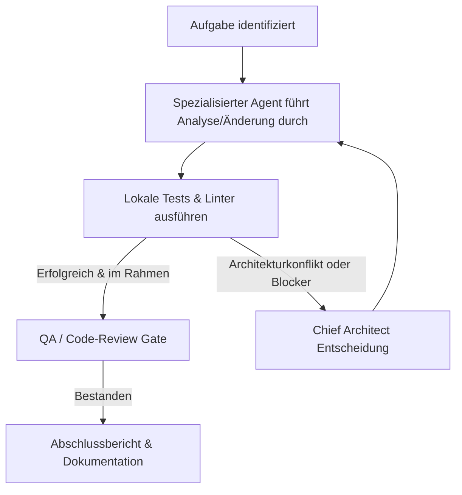

# AGENTS.md – REALITY CORP: THE AI WORLD TYCOON
**Version:** 1.0.0  
**Gültigkeit:** Verbindlich für alle KI-Agenten, Subagenten, Swarm-Worker und Pair-Programming-Sitzungen in diesem Workspace.  
**Koordination:** Chief Technical Architect

---

## 1. Unverhandelbare Kernprinzipien

Jeder Agent, der in diesem Repository Code liest, plant, ändert oder testet, unterliegt folgenden fundamentalen Mandaten:

1. **Qualität vor Geschwindigkeit:** Kein Feature wird überhastet ausgeliefert. Sauberkeit, Typsicherheit und Architektursicherheit haben absolute Priorität über schnellen Scheinerfolg.
2. **Keine improvisierten Architekturentscheidungen:** Fundamentale Änderungen (Frameworks, Datenmodelle, Simulations-Paradigmen) dürfen nur durch den *Chief Architect* mit formalem Architecture Decision Record (ADR) entschieden werden.
3. **Keine unnötigen Abhängigkeiten:** Jede Third-Party-Bibliothek erhöht Wartungsaufwand, Bundle-Größe und Angriffsfläche. Standard-APIs und schlanke In-House-Lösungen sind stets zu bevorzugen.
4. **Keine doppelten Implementierungen:** Vor dem Schreiben neuer Hilfsfunktionen ist die bestehende Codebasis zu durchsuchen. Gemeinsame Logik gehört in dedizierte Utility- oder Core-Module.
5. **Keine ungetesteten Änderungen als fertig melden:** Eine Aufgabe ist erst abgeschlossen, wenn begleitende automatisierte Tests (Unit, Integration oder E2E) existieren und nachweislich bestanden wurden.
6. **Keine Sicherheitslücken akzeptieren:** Null Toleranz für unvalidierte Client-Eingaben, fehlende RLS-Policies, exponierte Service-Keys oder ungesicherte Endpunkte.
7. **Keine erfundenen Testergebnisse:** Testergebnisse, Profiling-Werte und Benchmarks müssen durch tatsächliche CLI-Tool-Ausführung belegt sein. Halluzinierte Erfolge sind ein Verstoß gegen die Kern-Governance.
8. **Keine unnötigen Abkürzungen:** Keine `TODO: fix later`-Altlasten im Hauptzweig, keine unvollständigen Mocks in Produktivpfaden.
9. **Keine riesigen monolithischen Dateien:** Module müssen strikt fokussiert sein (Single Responsibility Principle). Dateigrößen über 300 Zeilen erfordern eine Prüfung auf Dekomposition.
10. **Jede Funktion muss nachvollziehbar und wartbar sein:** Selbsterklärender Code mit präzisen TypeScript-Typen und aussagekräftiger Benennung. Komplexe Algorithmen werden durch TSDoc und mathematische Herleitung dokumentiert.
11. **Bestehende Architektur vor Änderungen verstehen:** Vor jeder Modifikation muss der umgebende Code und Datenfluss vollständig analysiert werden.
12. **Fehler zuerst reproduzieren, dann beheben:** Bei Bugs wird zuerst ein minimaler, fehlschlagender Testfall geschrieben, der das Problem reproduziert, bevor Produktivcode geändert wird.
13. **Mobile Performance immer berücksichtigen:** 60 FPS Ziel-Framerate auf Mobilgeräten ($16.6\text{ms}$ Frame-Budget), Touch-Targets $\ge 48\text{px}$, striktes Akku- und Speichermanagement.
14. **Offline-Funktionalität und Server-Sicherheit berücksichtigen:** Vollständige Spielbarkeit im Flugmodus (Local-First mit IndexedDB/LocalStorage). Serveranbindungen dienen der asynchronen Synchronisation und dem Cheating-geschützten Leaderboard.

---

## 2. Autonomie & Sicherheitsgrenzen

### Erlaubte autonome Aktionen (ohne Vorab-Rückfrage):
- Lesen und Analysieren des gesamten Workspace.
- Anlegen und Bearbeiten von Dokumentations- und Spezifikationsdateien.
- Erstellen von Quellcode und Konfigurationen innerhalb des Workspace `REALITY-CORP`.
- Ausführen ungefährlicher Entwicklungs-, Build-, Linter- und Test-Befehle im lokalen Terminal.
- Refactorings innerhalb zugewiesener Modulgrenzen mit vollständiger Testabdeckung.

### Streng zustimmungspflichtige Aktionen (erfordern explizite Benutzerfreigabe):
- Änderungen an Produktionsdatenbanken oder externen Hosting-Diensten.
- Veröffentlichen oder Pushen von Git-Commits auf externe Remote-Repositories.
- Installation unbekannter Softwarepakete oder globaler Binaries.
- Aktivierung von kostenpflichtigen APIs oder Cloud-Diensten.
- Speicherung oder Übertragung von Secrets, Tokens oder Passwörtern.
- Destruktive Terminaloperationen (Löschen von Repositories, Force-Pushes, Massen-Dateilöschungen).

---

## 3. Eskalations- und Übergabeprozess

Bei Unklarheiten oder architekturellen Richtungsentscheidungen entscheidet stets der **Chief Architect**. Jede fundamentale Entscheidung wird in `docs/decisions/` als ADR festgehalten.

