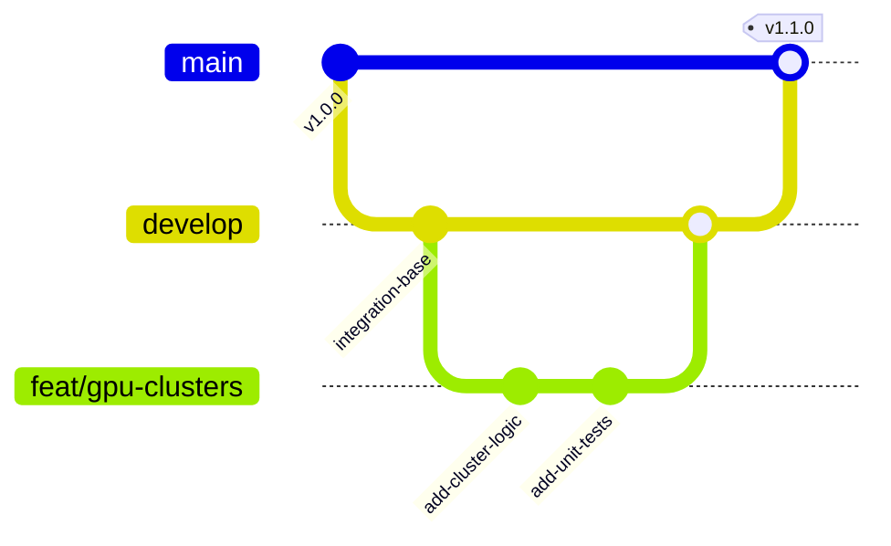

# Richtlinien für Beiträge (CONTRIBUTING.md)

Willkommen bei **REALITY CORP: THE AI WORLD TYCOON**. Wir legen allerhöchsten Wert auf Codequalität, deterministische Spiellogik, Typsicherheit und strikte Schichtenarchitektur.

---

## 1. Branching & Git-Flow

Unser Repository folgt einem sauberen Git-Flow:

- **`main`:** Produktions-Branch. Stabil, auslieferbar, geschützt. **Keine direkten Commits!**
- **`develop`:** Integrations-Branch für fertige Features.
- **`feat/<feature-name>`:** Neue Spielfunktionen, UI-Panels oder Engines (abgeleitet von `develop`).
- **`fix/<bug-name>`:** Bugfixes und Korrekturen.
- **`perf/<optimization>`:** Performance-Verbesserungen und Profiling.

---

## 2. Commit-Standards (Conventional Commits)

Jeder Commit-Kommentar muss dem Standard folgen:
`<type>(<scope>): <kurze Beschreibung im Imperativ>`

Zulässige Typen:
- `feat`: Neues Gameplay-Feature oder neue UI-Komponente
- `fix`: Behebung eines Fehlers (inkl. vorangegangenem Regressionstest)
- `perf`: Optimierung der Renderzeit, des Speichers oder der Tick-Geschwindigkeit
- `test`: Hinzufügen oder Refaktorisieren von Tests
- `refactor`: Codeänderung ohne Verhaltensänderung
- `docs`: Änderungen an Dokumentation oder ADRs
- `chore`: Wartungsarbeiten, Abhängigkeits-Updates

---

## 3. Pull Request Prozess

1. **Testabdeckung:** Jeder PR für neue Logik muss begleitende Unit- oder Integrationstests enthalten.
2. **Typecheck & Linter:** `pnpm check` und `pnpm lint` müssen mit 0 Fehlern und 0 Warnungen bestehen.
3. **Template ausfüllen:** Das PR-Template unter `.github/pull_request_template.md` ist vollständig auszufüllen (Zweck, Änderungen, Testnachweise, Checkliste).
4. **Review:** Jeder PR erfordert mindestens eine Freigabe durch den zuständigen Specialist-Agenten oder den Chief Architect.

---

## 4. Wichtige Verbote (Anti-Patterns)
- Keine Verwendung von `any` in TypeScript.
- Keine direkten Mutationen auf dem Simulation Core State aus UI-Komponenten heraus.
- Keine unkomprimierten Bild- oder Audio-Dateien im Git einchecken.
- Keine Secrets oder `.env`-Dateien committen.
