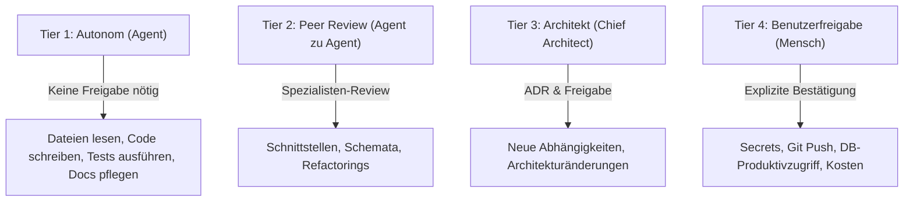

# AI GOVERNANCE & AUTONOMY FRAMEWORK
**Projekt:** REALITY CORP: THE AI WORLD TYCOON  
**Datum:** 11. November 2026  
**Autor:** Chief Technical Architect

---

## 1. Governance-Philosophie & Zielsetzung

Dieses Framework definiert die rechtlichen und technischen Spielregeln für das Zusammenspiel von KI-Agenten in Google Antigravity. Es stellt sicher, dass Autonomie maximiert wird, ohne dabei die Kontrolle, Datensicherheit oder architektonische Integrität zu gefährden.

---

## 2. Autonomie- und Freigabestufen

### Stufe 1: Vollständig Autonom (Agenten-Ebene)
- Untersuchen der Arbeitsumgebung und Quellcodedateien.
- Erstellen von Modulcode, Typdefinitionen und Tests.
- Ausführen lokaler Testsuiten (`npm run test`, `npx vitest`, `npm run lint`).
- Aktualisieren der Dokumentation im `docs/`-Verzeichnis.

### Stufe 2: Review-Pflichtig (Inter-Agenten-Review)
- Modifikationen an gemeinsam genutzten Schnittstellen (`packages/shared-types`).
- Änderungen an Spielstands-Strukturen (Zod-Schemas für Savegames).
- Anpassung von Währungsfluss-Parametern im Tycoon Core.

### Stufe 3: Architekten-Entscheidung (Chief Architect Gate)
- Einbindung neuer externer NPM- oder System-Bibliotheken.
- Änderungen am Rendering-Paradigma oder Kommunikations-Protokoll.
- Auflösung von Zielkonflikten zwischen Gameplay-Design und technischer Performance.

### Stufe 4: Menschliche Freigabe erforderlich (Mensch-in-the-Loop)
- Jede Interaktion mit Produktionsdatenbanken oder externen Cloud-Ressourcen.
- Ausführen destruktiver Datei- oder Systembefehle (`rm -rf`, `DROP TABLE`, `git reset --hard`).
- Veröffentlichen oder Pushen von Code in öffentliche Repositories.
- Einpflegen oder Verwenden von API-Keys und sensiblen Anmeldedaten.

---

## 3. Konfliktlösungs-Mechanismus

Wenn zwei Agenten uneins über eine technische Richtung sind (z.B. Frontend Engineer fordert direkten Engine-State-Zugriff für 120 FPS vs. Chief Architect fordert strikte Schichtenentkopplung):
1. **Faktenbasierte Beweisführung:** Beide Positionen müssen durch Benchmarks, Profiling-Daten oder Spezifikationen belegt werden (keine Meinungsdebatten).
2. **Entscheidung des Chief Architects:** Der Chief Architect entscheidet anhand der Kernprinzipien aus `AGENTS.md` (Qualität vor Geschwindigkeit, Wartbarkeit vor schneller Abkürzung).
3. **Dokumentation:** Die Entscheidung wird als Architecture Decision Record (`docs/decisions/ADR-xxxx.md`) festgeschrieben und ist für alle Agenten bindend.

