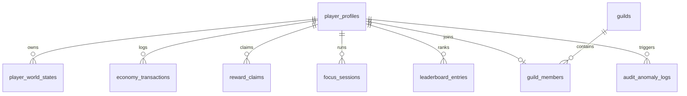

# DATABASE DESIGN SPECIFICATION (POSTGRESQL & SUPABASE)
**Projekt:** REALITY CORP: THE AI WORLD TYCOON  
**Datum:** 11. November 2026  
**Basis:** PostgreSQL 16/17 via Supabase + Supavisor Connection Pooler

---

## 1. Design-Prinzipien (Zero-Trust & Hybrid-Persistenz)

1. **Hybrides Datenmodell (Relational + JSONB):**
   - **Relational (3NF):** Profile, Welt-Indizes, Transaktions-Ledger, Reward-Claims, Guilds, Leaderboards, Focus-Sessions.
   - **Validiertes `jsonb`:** Dynamische Gebäude-Grids, Forschungsbäume und KI-Manager-Konfigurationen pro Welt. Dadurch erfordern neue Gebäude in `packages/game-config` keine Tabellen-Migrationen.
2. **Zero-Trust Row-Level Security (RLS):**
   - Auf jeder öffentlichen Tabelle ist `ENABLE ROW LEVEL SECURITY` Pflicht.
   - Alle Policies nutzen `(SELECT auth.uid())` (Subquery-Wrapping verhindert zeilenweise Neuauswertung von `auth.uid()`).
   - Schreibzugriffe auf kritische Ökonomie-Tabellen sind für direkte Browser-Clients gesperrt und erfolgen **ausschließlich** über `apps/backend` (Dual-Client-Pattern) bzw. atomare PostgreSQL RPCs.
3. **Indizierungspflicht:** Jeder Fremdschlüssel (`user_id`, `guild_id`, `world_id`) besitzt einen B-Tree-Index.

---

## 2. Entity-Relationship-Übersicht



---

## 3. Tabellen-Spezifikation

### 3.1 `player_profiles`
| Spalte | Typ | Constraints | Beschreibung |
| :--- | :--- | :--- | :--- |
| `id` | `uuid` | `PRIMARY KEY REFERENCES auth.users(id) ON DELETE CASCADE` | Verknüpft mit Supabase Auth |
| `username` | `text` | `UNIQUE NOT NULL` | Öffentlicher Firmen-/Spielername |
| `role` | `text` | `NOT NULL DEFAULT 'player'` | `'player' | 'admin'` |
| `trust_status` | `text` | `NOT NULL DEFAULT 'verified'` | `'verified' | 'shadow_flagged' | 'suspended'` |
| `active_world_id` | `text` | `NOT NULL DEFAULT 'apex-syndicate'` | Aktuell aktive Welt |
| `unlocked_worlds` | `text[]` | `NOT NULL DEFAULT '{apex-syndicate}'` | Freigeschaltete Welten |
| `created_at` | `timestamptz` | `NOT NULL DEFAULT now()` | Erstellungszeitpunkt |
| `updated_at` | `timestamptz` | `NOT NULL DEFAULT now()` | Letzte Aktualisierung |

### 3.2 `player_world_states` (Pro Spieler & Welt ein Zustand)
| Spalte | Typ | Constraints | Beschreibung |
| :--- | :--- | :--- | :--- |
| `id` | `uuid` | `PRIMARY KEY DEFAULT gen_random_uuid()` | Primärschlüssel |
| `user_id` | `uuid` | `NOT NULL REFERENCES player_profiles(id) ON DELETE CASCADE` | Besitzer |
| `world_id` | `text` | `NOT NULL` | `'apex-syndicate' | 'chrono-forge' | 'sovereign-island'` |
| `state_version` | `bigint` | `NOT NULL DEFAULT 1` | Monoton steigender Optimistic-Locking-Zähler |
| `last_synced_seq` | `bigint` | `NOT NULL DEFAULT 0` | Letzte akzeptierte Client-Command-Sequenznummer |
| `cash_jsonb` | `jsonb` | `NOT NULL` | `{ "m": number, "e": number }` (BigVal) |
| `compute_jsonb` | `jsonb` | `NOT NULL` | `{ "m": number, "e": number }` |
| `data_jsonb` | `jsonb` | `NOT NULL` | `{ "m": number, "e": number }` |
| `lifetime_earnings_jsonb`| `jsonb` | `NOT NULL` | Kumuliertes Welteinkommen für Prestige |
| `prestige_count` | `int` | `NOT NULL DEFAULT 0` | Anzahl durchgeführter Resets |
| `prestige_currency_jsonb`| `jsonb` | `NOT NULL` | Verdiente `Equity Shares` |
| `buildings_jsonb` | `jsonb` | `NOT NULL DEFAULT '{}'` | Map von Building-IDs zu Level/Status |
| `research_jsonb` | `jsonb` | `NOT NULL DEFAULT '{}'` | Freigeschaltete Tech-Nodes |
| `managers_jsonb` | `jsonb` | `NOT NULL DEFAULT '{}'` | Aktive KI-Manager & Regeln |
| `last_server_tick_at`| `timestamptz` | `NOT NULL DEFAULT now()` | Autoritativer Zeitanker für Offline-Berechnung |
| `updated_at` | `timestamptz` | `NOT NULL DEFAULT now()` | Letzter Sync |

- **Unique Index:** `UNIQUE (user_id, world_id)`
- **RLS Index:** `CREATE INDEX idx_world_states_user ON player_world_states (user_id);`

### 3.3 `economy_transactions` (Idempotentes Audit-Ledger)
| Spalte | Typ | Constraints | Beschreibung |
| :--- | :--- | :--- | :--- |
| `id` | `uuid` | `PRIMARY KEY DEFAULT gen_random_uuid()` | Primärschlüssel |
| `user_id` | `uuid` | `NOT NULL REFERENCES player_profiles(id) ON DELETE CASCADE` | Spieler |
| `world_id` | `text` | `NOT NULL` | Betroffene Welt |
| `idempotency_key` | `uuid` | `NOT NULL` | Vom Client/Server erzeugte UUID |
| `action_type` | `text` | `NOT NULL` | `'purchase' | 'prestige' | 'reward' | 'sync_tick'` |
| `payload_jsonb` | `jsonb` | `NOT NULL` | Command-Details & Kosten |
| `created_at` | `timestamptz` | `NOT NULL DEFAULT now()` | Buchungszeitpunkt |

- **Idempotenz-Garantie:** `UNIQUE (user_id, idempotency_key)` – Doppelte Anfragen liefern den gecachten Erfolg statt doppelter Abbuchung.

### 3.4 `reward_claims` (Schutz vor doppelten Belohnungen)
| Spalte | Typ | Constraints | Beschreibung |
| :--- | :--- | :--- | :--- |
| `id` | `uuid` | `PRIMARY KEY DEFAULT gen_random_uuid()` | Primärschlüssel |
| `user_id` | `uuid` | `NOT NULL REFERENCES player_profiles(id) ON DELETE CASCADE` | Spieler |
| `world_id` | `text` | `NOT NULL` | Welt |
| `claim_key` | `text` | `NOT NULL` | Eindeutiger Schlüssel (z.B. `mission:m_01`, `daily:2026-11-11:c_02`, `ach:first_rack`) |
| `reward_jsonb` | `jsonb` | `NOT NULL` | Ausgezahlte Belohnung |
| `claimed_at` | `timestamptz` | `NOT NULL DEFAULT now()` | Zeitpunkt |

- **Doppel-Claim-Sperre:** `UNIQUE (user_id, claim_key)` – Auf DB-Ebene physikalisch unmöglich, dieselbe Mission oder Daily Challenge zweimal zu kassieren.

### 3.5 `focus_sessions`
| Spalte | Typ | Constraints | Beschreibung |
| :--- | :--- | :--- | :--- |
| `id` | `uuid` | `PRIMARY KEY DEFAULT gen_random_uuid()` | Session-ID |
| `user_id` | `uuid` | `NOT NULL REFERENCES player_profiles(id) ON DELETE CASCADE` | Spieler |
| `world_id` | `text` | `NOT NULL` | Zielwelt |
| `target_duration_sec` | `int` | `NOT NULL CHECK (target_duration_sec BETWEEN 300 AND 7200)` | Gewählte Fokuszeit (5–120 Min.) |
| `started_at` | `timestamptz` | `NOT NULL DEFAULT now()` | Server-Startzeitpunkt |
| `completed_at` | `timestamptz` | `NULL` | Abschlusszeitpunkt |
| `status` | `text` | `NOT NULL DEFAULT 'active'` | `'active' | 'completed' | 'aborted'` |

### 3.6 `guilds` & `guild_members`
- `guilds`: `id uuid PK`, `name text UNIQUE`, `tag text UNIQUE`, `owner_id uuid FK`, `level int`, `max_members int DEFAULT 30`, `created_at timestamptz`.
- `guild_members`: `id uuid PK`, `guild_id uuid FK ON DELETE CASCADE`, `user_id uuid UNIQUE FK ON DELETE CASCADE` (1 Gilde pro Spieler), `role text`, `joined_at timestamptz`.
- **Indizes:** `idx_guild_members_guild (guild_id)`, `idx_guild_members_user (user_id)`.

### 3.7 `leaderboard_entries` (Big-Number-kompatibles SQL-Ranking)
| Spalte | Typ | Constraints | Beschreibung |
| :--- | :--- | :--- | :--- |
| `id` | `uuid` | `PRIMARY KEY DEFAULT gen_random_uuid()` | Eintrag-ID |
| `user_id` | `uuid` | `NOT NULL REFERENCES player_profiles(id) ON DELETE CASCADE` | Spieler |
| `world_id` | `text` | `NOT NULL` | Welt |
| `season_id` | `text` | `NOT NULL DEFAULT 'global'` | Saison oder `'global'` |
| `score_exponent` | `int` | `NOT NULL DEFAULT 0` | Zehnerexponent ($10^e$) |
| `score_mantissa` | `double precision` | `NOT NULL DEFAULT 0` | Normalisierte Mantisse $[1.0, 10.0)$ |
| `is_verified` | `boolean` | `NOT NULL DEFAULT true` | `false`, falls Spieler im Anti-Cheat geflaggt |
| `updated_at` | `timestamptz` | `NOT NULL DEFAULT now()` | Letztes Update |

- **Unique Key:** `UNIQUE (user_id, world_id, season_id)`
- **Ranking-Index:** `CREATE INDEX idx_leaderboard_rank ON leaderboard_entries (world_id, season_id, is_verified, score_exponent DESC, score_mantissa DESC);`
  *Begründung:* Ermöglicht exakte Big-Number-Sortierung über $10^{2\cdot 10^9}$ direkt über einen PostgreSQL B-Tree-Index ohne `numeric`-Bloat.

### 3.8 `game_events`, `analytics_events` & `audit_anomaly_logs`
- **`game_events`:** `id text PK`, `world_id text`, `title text`, `modifier_jsonb jsonb`, `starts_at timestamptz`, `ends_at timestamptz`, `is_active boolean`.
- **`analytics_events`:** `id bigint GENERATED ALWAYS AS IDENTITY PK`, `anon_session_id uuid`, `world_id text`, `event_name text`, `props_jsonb jsonb`, `created_at timestamptz` (keine PII!).
- **`audit_anomaly_logs`:** `id uuid PK`, `user_id uuid FK`, `world_id text`, `anomaly_type text`, `details_jsonb jsonb`, `created_at timestamptz` (**RLS: Vollständig gesperrt für `anon` und `authenticated`**; nur `service_role` darf schreiben/lesen).
- **RLS-Vollabdeckung über sämtliche Tabellen:** `ENABLE ROW LEVEL SECURITY` ist auf allen öffentlichen Tabellen aktiv. Direkte Schreibzugriffe (`INSERT`/`UPDATE`/`DELETE`) über `anon`/`authenticated` werden auf Ökonomie-, Sync-, Claim-, Focus-, Leaderboard-, Event- und Analytics-Tabellen per `AS RESTRICTIVE` gesperrt; `analytics_events` ist auch für `SELECT` durch `anon`/`authenticated` gesperrt (Auswertung nur über `apps/backend` / `service_role`).

---

## 4. Atomare Transaktionen, RPC-Härtung & Datenschutz (DSGVO)

- **Atomare RPCs & Execute-Lockdown:** Zustandsänderungen (z. B. `prestige_reset`, `claim_reward`, `sync_world_batch`) werden als PostgreSQL PL/pgSQL-Funktionen (`SECURITY DEFINER` mit explizitem `SET search_path = public`) ausgeführt. Um direkten PostgREST-Missbrauch zu verhindern, gilt zwingend:
  ```sql
  REVOKE EXECUTE ON FUNCTION sync_world_batch FROM PUBLIC, anon, authenticated;
  GRANT EXECUTE ON FUNCTION sync_world_batch TO service_role;
  ```
- **Connection Pooling:** `apps/backend` verbindet über den Supabase **Supavisor Pooler im Transaction Mode** (Port 6543) für skalierbare Parallelanfragen ohne Erschöpfung des Connection-Limits.
- **Datenschutz & Aufbewahrung:** `DELETE /v1/profile/me` löscht den Auth-Nutzer (`auth.users`), was per `ON DELETE CASCADE` sämtliche Spielstände, Claims und Profil-PII entfernt. `analytics_events` speichert keine IP-Adressen oder User-IDs und unterliegt einer 90-Tage-Retention; `audit_anomaly_logs` wird nach 180 Tagen anonymisiert/bereinigt.

---

## 5. Beispielhafte RLS-Policies (Performance-optimiert & Safe)

```sql
ALTER TABLE player_world_states ENABLE ROW LEVEL SECURITY;

-- Spieler dürfen nur ihre eigenen Weltenstände lesen (Subquery-Wrapping für O(1)-Auth-Check)
CREATE POLICY "Read own world states"
ON player_world_states FOR SELECT
TO authenticated
USING ((SELECT auth.uid()) = user_id);

-- Da keine permissive INSERT/UPDATE/DELETE Policy existiert, sind Client-Schreibzugriffe implizit gesperrt.
-- Zusätzlich erzwingt eine RESTRICTIVE Policy den Schreibschutz auch bei künftigen Policies:
CREATE POLICY "Restrict direct client writes"
ON player_world_states AS RESTRICTIVE FOR ALL
TO anon, authenticated
USING (true)
WITH CHECK (false);
```

