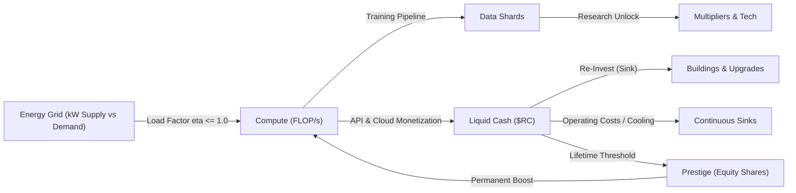

# GAME ECONOMY & ANTI-CHEAT SPECIFICATION
**Projekt:** REALITY CORP: THE AI WORLD TYCOON  
**Datum:** 11. November 2026  
**Gültigkeit:** `packages/economy-engine`, `packages/game-config`, `apps/backend`

---

## 1. Wirtschaftsarchitektur & Ressourcen-Kreislauf

Die Ökonomie von *REALITY CORP* basiert auf einem gekoppelten Multi-Ressourcen-System, das für alle Welten über `world_id` konfiguriert wird (MVP-Fokus: **`apex-syndicate`**).

### Währungsebenen
1. **Liquid Cash (`$RC`):** Primäre Investitionswährung für Gebäude, Hardware-Upgrades und KI-Manager.
2. **Compute (`FLOP/s` & `Compute Cycles`):** Rechenleistung; direkt abhängig von verfügbarer Hardware und elektrischer Energie.
3. **Energy (`kW`):** Kapazitätsgrenze (Supply vs. Demand). Übersteigt der Bedarf die Versorgung, greift kein harter Absturz, sondern ein sanfter **Brownout-Load-Faktor**:
   $$\eta = \min\left(1.0,\ \frac{\text{TotalEnergySupply}}{\max(1,\ \text{TotalEnergyDemand})}\right)$$
   Dieser Faktor skaliert alle Erträge proportional nach unten und zwingt zu strategischem Ausbau der Strominfrastruktur.
4. **Data (`Data Shards`):** Generiert durch Datensammlung/Scraping-Nodes; wird als Sink für **Research Tree** und KI-Modell-Training verbraucht.
5. **Prestige-Währung (`Equity Shares` in Apex Syndicate):** Erworben beim Soft-Reset (Börsengang / Buyout); gewährt permanente Multiplikatoren und schaltet spätere Welten frei.

---

## 2. Deterministische Formeln

### 2.1 Einzel- und Bulk-Upgrade-Kosten
Für jedes Gebäude oder Upgrade mit Basiskosten $B$, Wachstumsrate $r \in [1.07, 1.15]$ und aktuellem Level $n$:
$$\text{Cost}_{\text{single}}(n) = \left\lceil B \cdot r^n \right\rceil$$

Für **"Buy $k$" / "Buy Max"** (geometrische Reihe ohne Schleifen-Drift):
$$\text{Cost}_{\text{bulk}}(n, k) = B \cdot r^n \cdot \frac{r^k - 1}{r - 1}$$

Maximale kaufbare Menge $k_{\max}$ bei Guthaben $W$:
$$k_{\max} = \left\lfloor \log_r\left( 1 + \frac{W \cdot (r - 1)}{B \cdot r^n} \right) \right\rfloor$$

### 2.2 Produktions- und Ertragsformel
$$\text{Yield}(n) = Y_0 \cdot n \cdot \eta_{\text{energy}} \cdot M_{\text{milestone}}(n) \cdot M_{\text{research}} \cdot M_{\text{prestige}} \cdot M_{\text{focus}} \cdot M_{\text{event}}$$
- **Meilenstein-Multiplikatoren:** Faktor $2\times$ bei Level 25, 50, 250; Faktor $4\times$ bei Level 100, 500, 1000.
- **Additive vs. Multiplikative Gruppen:** Boni innerhalb derselben Kategorie (z. B. mehrere Research-Nodes) werden addiert; unterschiedliche Kategorien (Milestone $\times$ Research $\times$ Prestige) werden multipliziert.

### 2.3 Prestige-Skalierung (Wurzel-Dämpfung gegen Explosion)
$$\text{TotalEarnedShares}(E_{\text{lifetime}}) = \left\lfloor S \cdot \left(\frac{E_{\text{lifetime}}}{T_0}\right)^{0.5} \right\rfloor$$
$$\text{ClaimableOnReset} = \max\left(0,\ \text{TotalEarnedShares} - \text{AlreadyClaimedShares}\right)$$
($T_0$ = Schwellenwert für den ersten Börsengang in `apex-syndicate`, z. B. $10^9\text{ \$RC}$).

---

## 3. Server-Authoritative Security & Anti-Cheat-Regeln

| Risiko / Angriff | Technische Gegenmaßnahme in REALITY CORP |
| :--- | :--- |
| **Manipulierte Client-Balances (Memory/DevTools)** | Client-Werte dienen nur der lokalen Darstellung. Das Backend lädt den letzten bestätigten Zustand aus `player_world_states` und simuliert sämtliche `commands` im Batch selbst nach. |
| **Systemuhr-Manipulation (Time-Travel Cheat)** | Offline-Zeit wird auf dem Server **ausschließlich** über `(serverNow - last_server_tick_at)` ermittelt (`clientTimestampMs` dient nur der lokalen Ordering-Reihenfolge innerhalb des erlaubten Fensters). |
| **Doppelte Käufe / Netzwerk-Retries** | Jeder Kauf und Sync-Command trägt eine `idempotencyKey` UUID. `economy_transactions` erzwingt `UNIQUE(user_id, idempotency_key)`. |
| **Doppelte Belohnungen (Race Conditions)** | `reward_claims` erzwingt `UNIQUE(user_id, claim_key)` innerhalb einer atomaren SQL-Transaktion. Parallele Requests für dieselbe Challenge erhalten sofort `409 ALREADY_CLAIMED`. |
| **Gefälschte Focus-Timer-Boosts** | `POST /v1/focus/start` speichert `started_at` auf dem Server. Erst wenn `(serverNow - started_at) >= 0.95 * target_duration_sec`, schaltet der Server den Boost frei. |
| **Unplausible Offline-/Tick-Raten** | Überschreitet ein eingereichter Zustand die theoretische Maximalproduktion um mehr als $5\,\%$, verwirft der Server das Delta, sendet `canonicalState` zurück, loggt in `audit_anomaly_logs` und markiert den Spieler ggf. im Leaderboard (`is_verified = false`). |

---

## 4. Sichere Offline-Berechnung (Offline Progress)

1. **Maximaler Offline-Zeitraum ($T_{\text{cap}}$):** Standardmäßig **8 Stunden** ($28.800\text{ s}$), durch Research-Tree auf bis zu 24 Stunden erweiterbar.
2. **Offline-Effizienzfaktor:** Standardmäßig **75 %** der Online-Produktionsrate (auf 100 % upgradebar).
3. **Analytische Berechnung ohne UI-Freeze:**
   - Konstante Generatoren werden in $O(1)$ per Multiplikation $\Delta t \cdot \text{Rate}$ berechnet.
   - Gekoppelte Ketten (falls aktiv) werden maximal in $N = 100$ deterministische Makro-Ticks unterteilt ($\Delta t_{\text{step}} = \Delta t / 100$), sodass sowohl Browser-Kaltstart als auch Backend-Batch-Sync in $< 2\text{ ms}$ durchlaufen.

---

## 5. Big-Number-Strategie & Zentralisierte Konfiguration

### 5.1 Big-Number-Repräsentation (`BigVal`)
- **Engine-Kern:** `break_infinity.js` gekapselt hinter einem strikten `BigVal`-Adapter in `packages/economy-engine` (50x–400x schneller als `decimal.js`, sicher bis $10^{9\times 10^{15}}$).
- **Wire-/JSONB-Format:** Normalisiert als `{ m: number, e: number }` ($1 \le |m| < 10$, ganzzahliger Exponent $e$), z. B. `1.5e42 -> { "m": 1.5, "e": 42 }`.
- **PostgreSQL-Leaderboard-Format:** Gespeichert in zwei indizierten Spalten `(score_exponent int, score_mantissa float8)` für exakte Index-Sortierung.

### 5.2 Zentralisierte Balance-Konfiguration (`packages/game-config`)
- Alle Basiskosten, Multiplikatoren, Forschungs-DAGs, Missionsziele und Welt-Definitionen (`apex-syndicate`, `chrono-forge`, `sovereign-island`) liegen zentral in `packages/game-config` und werden beim Start von Client und Server mit **Zod** validiert.
- Kein magischer Zahlenwert ("Magic Number") darf hartkodiert in Komponenten oder Engine-Funktionen stehen.

---

## 6. Automatisierte Economy-Tests (`tests/economy/`)

Vor jedem Balancing- oder Engine-Merge laufen in Vitest automatisiert:
1. **Formel-Unit-Tests:** Verifikation von Kostenkurven, Bulk-Buy-Äquivalenz ($\text{Cost}_{\text{bulk}}(n, k) \equiv \sum_{i=0}^{k-1} \text{Cost}(n+i)$ innerhalb IEEE-754-Mantissentoleranz) und Energie-Brownout-Faktoren.
2. **Invarianten-Tests:** Guthaben darf niemals negativ oder `NaN`/`Infinity` werden; `claim_key`-Duplikate werden abgewiesen.
3. **Greedy-Bot TTNM-Benchmark:** Ein Headless-Simulationsbot spielt `apex-syndicate` über simulierte 1h-, 24h- und 7d-Zeiträume durch und prüft, dass keine Softlocks auftreten und die *Time-to-Next-Milestone (TTNM)* im Zielkorridor bleibt.
