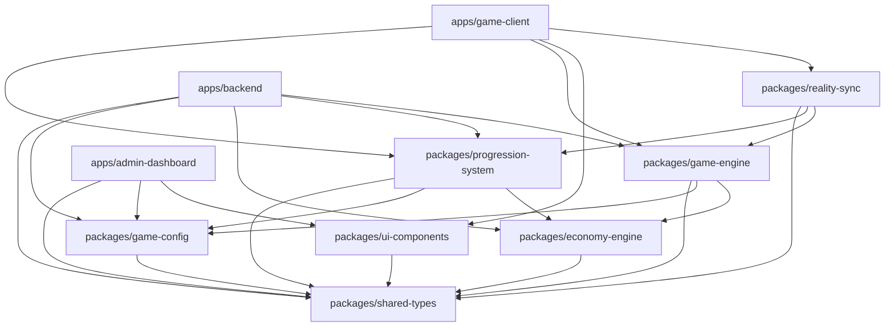

# PROJECT STRUCTURE & MONOREPO BLUEPRINT
**Projekt:** REALITY CORP: THE AI WORLD TYCOON  
**Datum:** 11. November 2026  
**Status:** Master Architecture Specification (Phase 05)

---

## 1. Monorepo-Verzeichnisbaum

Das Projekt wird als modulares **`pnpm`-Workspace-Monorepo** organisiert (`pnpm-workspace.yaml` mit `apps/*` und `packages/*`).

```
REALITY-CORP/
├── .agent/                         # Lokale Antigravity Skills & Spiegel der Regeln
├── .agents/                        # Primäre Antigravity Workspace Rules (13 Regelwerke)
├── .github/                        # CI/CD Workflows, PR- & Issue-Templates
├── apps/
│   ├── game-client/                # SvelteKit 5 (adapter-static) + Tailwind v4 + PixiJS v8 + Capacitor 8
│   │   ├── src/
│   │   │   ├── routes/             # Seiten & SPA-Fallback (+layout.ts mit prerender=false)
│   │   │   ├── lib/graphics/       # PixiJS v8 Scene Manager, Sprites, Viewport-Culling
│   │   │   ├── lib/bridge/         # Capacitor Haptics, App-Lifecycle, Safe-Area-Adapter
│   │   │   └── lib/state/          # Svelte 5 Runes State-Presenter (abonniert Engine/Sync)
│   │   ├── android/                # Generierte Capacitor Android Shell (nach `cap add android`)
│   │   ├── ios/                    # Generierte Capacitor iOS Shell (SPM-basiert)
│   │   └── capacitor.config.ts
│   ├── backend/                    # Modularer Node.js 24 Monolith (Fastify + TypeScript)
│   │   └── src/
│   │       ├── modules/            # sync, economy, progression, focus, guilds, leaderboards, admin
│   │       ├── plugins/            # Auth (JWT Verify), Rate-Limit, Zod-Validation, Error-Handler
│   │       └── db/                 # Dual-Client Supabase (User-JWT vs. Admin Service Role) & Supavisor
│   └── admin-dashboard/            # SvelteKit 5 Internal Ops UI (Balance-Inspektor, Events, Audit-Logs)
├── packages/
│   ├── shared-types/               # Branded Types, WorldId, Command/Event DTOs, Zod-Contracts
│   ├── game-config/                # Zentralisierte Balance-Daten (Apex Syndicate MVP + World-Stubs)
│   ├── economy-engine/             # BigVal (break_infinity.js), Kosten/Ertragsformeln, Offline-Math
│   ├── game-engine/                # Deterministische State-Machine: Building, Production, Energy, Data, AI Manager, Focus
│   ├── progression-system/         # Research Tree, Prestige, Missions, Daily Challenges, Achievements
│   ├── reality-sync/               # Local-First IndexedDB Store, Offline Command Queue, Idempotency & Reconciliation
│   └── ui-components/              # Wiederverwendbare Svelte 5 UI-Primitiven (48px Touch, WCAG 2.1 AA)
├── supabase/
│   ├── migrations/                 # Versionierte PostgreSQL-Migrationen, Indizes, RLS & RPCs
│   └── seed.sql                    # Entwicklungs-Seed-Daten (Apex Syndicate Baseline)
├── tests/
│   ├── economy/                    # Automatisierte 24h/7d Greedy-Bot- & Invariant-Simulationen
│   ├── integration/                # Cross-Package Sync- & Reconciliation-Tests (Client <-> Backend Engine)
│   └── e2e/                        # Playwright E2E-Tests (Desktop 1920x1080 & Mobile 390x844)
├── docs/                           # Architektur, Security, Governance & Audit-Dokumente
├── AGENTS.md                       # 14 verbindliche Kernprinzipien
├── GEMINI.md                       # Master Governance Entry Point
├── pnpm-workspace.yaml
├── package.json
└── tsconfig.base.json
```

---

## 2. Abhängigkeitsgraph (Strikt azyklischer DAG)

Zirkuläre Abhängigkeiten sind verboten. Importe dürfen ausschließlich **von oben nach unten** erfolgen:



### Modulverantwortlichkeiten im Überblick

| Modul | Verantwortung | Verbotene Abhängigkeiten |
| :--- | :--- | :--- |
| **`packages/shared-types`** | Branded Types (`RealityCash`, `ComputeFlops`, `EnergyWatts`, `DataShards`), Zod-Schemas, DTOs | Keine internen Pakete |
| **`packages/game-config`** | Balance-Tabellen für `apex-syndicate` (und gesperrte Configs für `chrono-forge`, `sovereign-island`) | Keine Runtime-Logik, kein DOM |
| **`packages/economy-engine`** | `BigVal` Arithmetik, Kosten-/Ertragskurven, Energie-Load-Faktor, Prestige-Formel, analytischer Offline-Ertrag | Kein DOM, kein Network, kein UI |
| **`packages/game-engine`** | Deterministische Simulation: Building, Production, Cash, Energy, Data, AI Manager, Focus Timer | Kein DOM, kein Svelte, kein PixiJS, kein Supabase |
| **`packages/progression-system`** | Research Tree DAG, Prestige-Reset, Missions, Daily Challenges, Achievements, World-Unlock-Prüfung | Kein DOM, kein UI |
| **`packages/reality-sync`** | IndexedDB-Persistenz, Offline-Command-Queue, UUIDv4 Idempotency-Keys, Sync-Batching & Server-Reconciliation | Kein PixiJS, keine UI-Komponenten |
| **`packages/ui-components`** | Zustandslose Svelte 5 Komponenten, Big-Number-Formatierer, Accessible Modals & Charts | Keine direkten API-Calls oder Engine-Mutationen |
| **`apps/game-client`** | SvelteKit SPA, PixiJS v8 Canvas, Audio/Haptics, bindet `game-engine` + `reality-sync` zusammen | Keine Admin-Logik, kein `service_role` Key |
| **`apps/backend`** | Node.js 24 API, deterministischer Replay-Validator, Anti-Cheat, Auth-Prüfung, RPC-Orchestrierung | Kein Svelte/PixiJS |
| **`apps/admin-dashboard`** | Ops-UI für Live-Events, Balance-Inspektion und Anomalie-Logs | Kein Spiel-Loop |

---

## 3. Hinweis zu bestehendem Vorentwurf (`packages/simulation-core`)

Auf dem nicht gemergten Branch `feat/core-engine-scaffold` existiert ein früher Prototyp (`packages/simulation-core` + `packages/shared-types`). In **Phase 06 (Project Scaffolding)** werden diese Entwurfsdateien kontrolliert in die nun definierte Paketstruktur (`packages/economy-engine` + `packages/game-engine` + `packages/shared-types`) überführt bzw. bereinigt, sodass keine verwaisten Module verbleiben.
