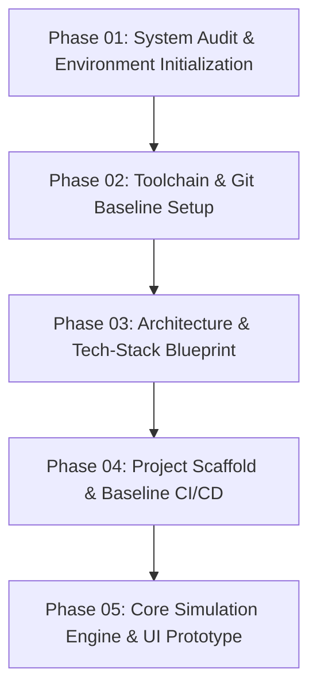

# SETUP PLAN: REALITY CORP – THE AI WORLD TYCOON

Dieses Dokument definiert den strukturierten Fahrplan zur schrittweisen Einrichtung der Entwicklungsumgebung, Architektur und Toolchain.

---

## Phasenübersicht

---

## Phase 01: System Audit & Environment Initialization (Aktueller Schritt)
- [x] Vollständige Hardware- & OS-Analyse
- [x] Runtimes & Toolchain-Prüfung (Node.js, npm, Python, Go, Docker, Git)
- [x] MCP-Server & Agent-Skills Bestandsaufnahme
- [x] Erstellung der Audit-Dokumente (`docs/`)
- [ ] Freigabe durch den Benutzer zur Einleitung von Phase 02

---

## Phase 02: Toolchain & Repository Setup (Vorschlag für den nächsten Schritt)
1. **Git Repository Initialisierung:**
   - `git init` im Projektordner ausführen.
   - Standard-Branch auf `main` konfigurieren.
   - Saubere `.gitignore` erstellen (Node, Python, Go, IDEs, Caches, OS-Dateien).
   - `.editorconfig` für plattformübergreifende Code-Formatierung einrichten.
2. **Paketmanager-Bereitstellung:**
   - Installation / Aktivierung von `pnpm` (z.B. via `npm install -g pnpm` oder Corepack).
   - Verifikation von `pnpm --version`.
3. **Projekt-Metadaten & Lizenz:**
   - Erstellung einer standardisierten `README.md` mit Projektvision, Tech-Stack und Getting Started.
   - Definition von Code-Style- und Linter-Regeln (TypeScript, ESLint, Prettier / Biome).

---

## Phase 03: Architektur & Tech-Stack Definition
1. **Frontend / Tycoon UI & World-Render Engine:**
   - Evaluierung der Rendering-Technologie für die Welt- und Agentenübersicht:
     - Option A: Modernes Web-Canvas / WebGL / Pixi.js / Three.js mit React/Vite (hohe Portabilität, blitzschnelle Iteration, direkt im Browser/Electron lauffähig).
     - Option B: Desktop/Native Wrapper via Electron oder Tauri.
     - Option C: Unity Engine (Unity MCP-Server vorhanden).
   - *Empfehlung des Architekten:* Web-basierter Stack (Vite + TypeScript + React/Tailwind + PixiJS / Canvas) für Tycoon-Management-Interfaces, da UI-lastige Tycoon-Games (Menüs, Diagramme, Firmen-Hierarchien, Finanzbäume) hier extrem agil, performant und automatisiert testbar (via Puppeteer MCP) entwickelt werden können.
2. **Simulation Core Engine:**
   - Deterministic Tick-basierte Engine (Agenten-KI, Markt-Fluktuation, Produktzyklen, Cashflow).
   - Vollständige Entkopplung von Simulation (Logik/State) und Präsentation (Rendering/UI).
3. **Persistenz & Save-Game Format:**
   - Strukturiertes JSON / SQLite-Format für robuste Spielstände und Replays.

---

## Phase 04: Project Scaffold & Baseline CI/CD
1. Monorepo- oder modularer Workspace-Aufbau (z.B. `packages/simulation-engine`, `packages/ui`, `packages/shared-types`).
2. Unit-Tests für Core-Algorithmen (Jest/Vitest).
3. Automatisierte End-to-End Smoke Tests mit dem integrierten `puppeteer` MCP-Server.

---

## Phase 05: Core Simulation Loop & AI Integration
1. Implementierung der fundamentalen Tycoon-Schleife:
   - Ressourcen-Management (Kapital, Rechenleistung, Talent, AI-Modelle).
   - Agenten-Einstellungs- und Weiterentwicklungssystem.
   - Marktreaktionen und Wettbewerber-KIs.

