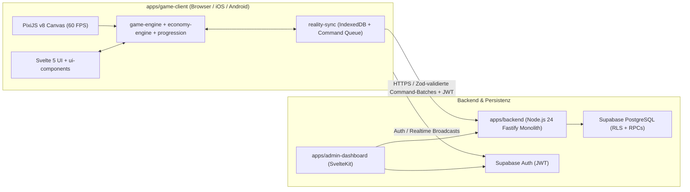
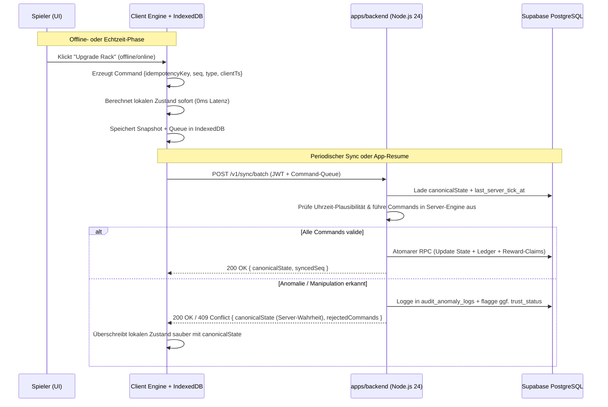

# MASTER TECHNICAL ARCHITECTURE (PHASE 05)
**Projekt:** REALITY CORP: THE AI WORLD TYCOON  
**Datum:** 11. November 2026  
**Autor:** Chief Technical Architect  
**Architekturstil:** Modularer Monolith (Node.js 24 + Supabase) & Entkoppelter Local-First Client (SvelteKit 5 + PixiJS v8 + Capacitor 8)

---

## 1. Systemtopologie (Keine Microservices, keine Überdimensionierung)

REALITY CORP verbindet reaktionsschnelles Offline-First-Gameplay auf Mobilgeräten und im Browser mit einer **server-authoritativen Wirtschafts- und Fortschrittsprüfung**.

### Warum genau diese Topologie?
- **Keine Microservices:** Ein einziger modularer Backend-Service (`apps/backend`) importiert `@reality-corp/game-engine` und `@reality-corp/economy-engine` direkt als Workspace-Pakete. Damit gibt es **eine einzige Wahrheit (Single Source of Truth)** für alle mathematischen Formeln.
- **Keine unnötigen Echtzeit-Sockets für Core-Economy:** Tycoon-Spiele benötigen kein 60-Hz-Multiplayer-State-Streaming. Client-Ticks laufen lokal deterministisch; Zustandsabgleiche erfolgen periodisch (alle 30–60 s), bei Meilensteinen/Käufen sowie beim App-Start.

---

## 2. Architektur der 20 Spielsysteme

Alle 20 geforderten Spielsysteme sind strikt den definierten Monorepo-Modulen zugeordnet:

| # | Spielsystem | Primäres Paket | Client-Aufgabe (Optimistic) | Server-Aufgabe (Authoritative) |
| :- | :--- | :--- | :--- | :--- |
| 1 | **Building System** | `game-engine` | Platzierung & Upgrade-Preview im Grid; PixiJS-Rack-Rendering | Prüft Freischaltung, Slot-Limits & Kosten gegen Config |
| 2 | **Production System** | `game-engine` | Führt deterministischen Tick-Loop aus (`Energy -> Compute -> Data -> Cash`) | Berechnet identische Produktionsrate beim Batch-Replay |
| 3 | **Economy Engine** | `economy-engine` | `BigVal` Arithmetik (`break_infinity.js`), Bulk-Buy-Summen | Exakt identische Bibliothek; prüft Überläufe & Grenzwerte |
| 4 | **Cash System** | `game-engine` | Zeigt `$RC`-Kontostand & Cashflow/s im UI (10 Hz UI-Throttle) | Führt unveränderliches Ledger (`economy_transactions`) |
| 5 | **Energy System** | `game-engine` | Berechnet Netzlast $\eta = \min(1, \text{Supply}/\text{Demand})$ | Validiert Kraftwerk-Kapazität & Drosselungsfaktor |
| 6 | **Data System** | `game-engine` | Akkumuliert Training-Data-Shards bis zum Speichercap | Prüft Storage-Limits und Modell-Trainings-Verbrauch |
| 7 | **Research Tree** | `progression-system` | DAG-Prüfung (Voraussetzungen erfüllt?), schaltet Boni frei | Verifiziert Tech-DAG, Ressourcenabzug & Idempotenz |
| 8 | **AI Manager** | `game-engine` | Steuert Auto-Collector & Auto-Upgrader anhand Regeln | Reproduziert Manager-Aktionen deterministisch im Replay |
| 9 | **Prestige System** | `progression-system` | Zeigt projizierte Prestige-Währung (`Equity Shares`) | Führt atomaren Soft-Reset via Postgres RPC aus |
| 10 | **Offline Progress** | `economy-engine` | Zeigt "Welcome Back"-Modal mit geschätztem Ertrag | Berechnet autoritativen $\Delta t$-Ertrag (Cap + Clock Sanity) |
| 11 | **Missions** | `progression-system` | Trackt Fortschritt gegen aktuelle Meilensteine | Verhindert Doppelbelohnung via `reward_claims` Unique Key |
| 12 | **Daily Challenges** | `progression-system` | Zeigt tagesaktuelle UTC-Aufgaben und Restzeit | Generiert tagesdeterministische Challenges; prüft Claim-Fenster |
| 13 | **Focus Timer** | `game-engine` | Lokal laufender Pomodoro-/Deep-Work-Timer (kein Internet nötig) | Validiert `started_at` vs. `completed_at` Mindestdauer beim Sync |
| 14 | **Reality Sync** | `reality-sync` | Persistiert Savegame + Command-Queue in IndexedDB | Nimmt Batches an, erkennt Konflikte, liefert `canonicalState` |
| 15 | **Player Profiles** | `backend` / `shared-types` | Anzeige von Name, Trust-Status, gewählter Welt | Verwaltet Profil über Supabase Auth + RLS (`auth.uid()`) |
| 16 | **Achievements** | `progression-system` | Schaltet lokale Trophäen-Popups frei | Speichert dauerhafte Achievements idempotent in Postgres |
| 17 | **Guilds** | `backend` | Anzeige von Syndikat-Mitgliedern & passiven Gilden-Perks | Verwaltet Mitgliedschaften & Perks über Postgres-Transaktionen |
| 18 | **Leaderboards** | `backend` | Paginierte Ranglisten-Ansicht nach Welt/Season | Indizierte Abfrage; filtert `trust_status = 'verified'` |
| 19 | **Events** | `game-config` / `backend` | Aktiviert temporäre Multiplikatoren/Event-Banners | Steuert globale UTC-Start-/Endzeiten über Admin-Dashboard |
| 20 | **Analytics** | `reality-sync` / `backend` | Puffert anonyme Funnel-/TTNM-Events lokal im Batch | Schreibt Events asynchron in `analytics_events` ohne PII |

---

## 3. Weltstruktur & MVP-Fokus

Das Datenmodell und sämtliche Balancing-Konfigurationen sind von Tag 1 an über `world_id` parametrisiert:

| Welt-ID | Name | Setting & Fokus | Status |
| :--- | :--- | :--- | :--- |
| **`apex-syndicate`** | **Apex Syndicate** | Corporate AI-Konzern: Vom Garagen-Server zum planetaren Cloud-Monopol. | **MVP (Vollständig vorbereitet)** |
| **`chrono-forge`** | **Chrono Forge** | Post-MVP: Temporale Quanten-Compute-Cluster & Hochfrequenz-Marktsimulation. | **Konfigurations-Stub (Gesperrt)** |
| **`sovereign-island`** | **Sovereign Island** | Post-MVP: Autonomer Offshore-AGI-Stadtstaat mit eigenem Strom-/Seekabelnetz. | **Konfigurations-Stub (Gesperrt)** |

**Architekturprinzip:** Alle drei Welten teilen sich exakt dieselben Engines (`game-engine`, `economy-engine`, `progression-system`). Neue Welten werden ausschließlich über Konfigurationen in `packages/game-config` und eigene Startzustände in `player_world_states` aktiviert – kein Engine-Rewrite nötig.

---

## 4. Hybrid Offline-First & Server-Reconciliation Flow

---

## 5. Rendering-, Performance- & Mobile-Architektur

1. **PixiJS v8 Lifecycle in Svelte 5:**
   - Asynchrone Initialisierung (`await app.init({ resizeTo, preference: 'webgl' })`) gekapselt in einem `$effect` mit striktem Teardown (`app.destroy(true, { children: true, texture: true })`).
   - **UI-Trennung:** PixiJS rendert ausschließlich die Welt/Server-Racks/Partikel ($< 30$ Draw Calls via Texture-Atlanten). Alle Texte, Dialoge und Listen laufen im Svelte 5 DOM Overlay.
2. **Frame-Budget ($16.6\text{ms}$ @ 60 FPS):**
   - Simulation-Tick entkoppelt von Render-FPS (fester `100ms` Simulationsschritt oder deterministisches `dt`-Accumulator-Step, UI-Zahlen-Updates auf `10 Hz` gedrosselt, um Svelte-DOM-Reflows zu minimieren).
   - Bei `document.hidden` oder Capacitor `appStateChange (inactive)`: Sofortiges Pausieren des Pixi-Tickers; Nachberechnung beim Resume über `Offline Progress`.
3. **Capacitor 8 Mobile Shell:**
   - SvelteKit baut per `@sveltejs/adapter-static` (`fallback: 'index.html'`) ein reines SPA-Bundle nach `build/`.
   - Native Bridges (`@capacitor/haptics`, `@capacitor/app`, Safe-Area-Insets) werden ausschließlich hinter `Capacitor.isNativePlatform()`-Guards aufgerufen.
